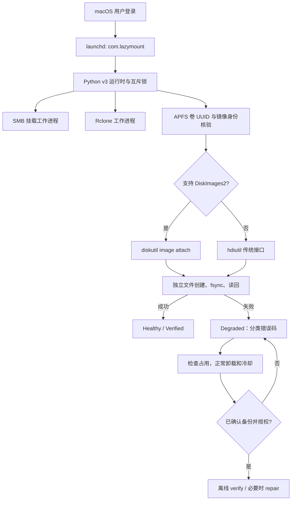

# LazyMount-Mac

[](https://opensource.org/licenses/MIT)
[](https://www.apple.com/macos/)

**[📖 English Documentation](README.md)**

> **轻松扩展 Mac 存储空间** — 开机自动挂载 SMB 共享和云存储，全程无需手动操作。

## 项目结构

.  
├──[README.md](README.md) — 英文文档  
├──[README_CN.md](README_CN.md) — 中文文档  
├──[CHANGELOG.md](CHANGELOG.md) — 版本变更及升级说明
├──[LICENSE](LICENSE) — MIT 许可证  
├──[install.sh](install.sh) / [install.py](install.py) — 自动安装、升级、旧版本迁移及失败回滚
├──[mount_manager.sh](mount_manager.sh) — SMB/Rclone 配置与启动脚本
├──[lazymount_runtime.py](lazymount_runtime.py) — DiskImages2/APFS 校验及恢复引擎
├──[mount_manager.example.local.sh](mount_manager.example.local.sh) — 配置示例（真实用户配置由安装器保留）
├──[com.lazymount.plist](com.lazymount.plist) — LaunchAgent 模板，安装时自动生成
├──[tests](tests) — 单元测试和可选 APFS 实测
└──[docs/validation-v3.md](docs/validation-v3.md) — 测试记录和适用限制


---

## 目录 (Table of Contents)

- [为什么选择 LazyMount？](#为什么选择-lazymount)
- [安装](#安装)
  - [前置要求](#前置要求)
  - [安装 FUSE 接口](#fuse-install)
- [配置说明](#configuration)
- [使用 Tailscale 远程访问](#使用-tailscale-远程访问)
- [使用场景示例](#使用场景示例)
- [新手详细教程](#新手详细教程)
- [常见问题 (FAQ)](#faq)

---

<div align="center">
  
  <p><em>LazyMount-Mac 终端运行日志 — 网络连通性检测、凭据安全校验与自动化挂载状态恢复</em></p>
</div>

---

## 为什么选择 LazyMount？

Mac 存储空间**太贵了** — 升级 1TB 要多花 ¥1500+。LazyMount 帮你用外部存储无缝扩展 Mac：

- **[游戏库](#1-nas-上的-steam-游戏库)** — 把 Steam/Epic 游戏放在 NAS 上，玩起来跟本地一样
- **[时间机器备份](#2-时间机器备份到远程服务器)** — 自动备份到远程服务器
- **[媒体库](#3-媒体服务器-plex-jellyfin-片源)** — 随时访问存放在家庭服务器上的电影/音乐
- **[项目归档](#5-公司项目归档)** — 大文件放在便宜的存储上，按需访问
- **[云存储](#4-google-drive-dropbox-当本地文件夹)** — 把 Google Drive、Dropbox 或任何 rclone 支持的服务挂载成本地文件夹
- **[AI 模型存储](#6-ai-大模型存储库)** — 将大模型存放在网络驱动器上，节省本地 SSD 空间

**核心特性（v3.0.2）：**
- **免用户名安装器** — 自动识别 HOME/UID，迁移旧版 launchd Label，并保留本地设置
- **独立 SMB / Rclone 工作进程** — APFS 故障不会导致正常网络挂载停止
- **真实 APFS 写入校验** — 随机 4 KiB 临时文件，执行创建、写入、fsync、读回和清理；不再用 `df` 假装可写
- **自动选择 DiskImages2** — macOS 支持时优先 `diskutil image attach`，旧系统保留 `hdiutil`；新后端失败不回退到旧后端
- **保守恢复** — UUID 与物理存储核验、空闲状态检查、正常卸载、冷却期，必要时经备份授权进行离线 First Aid
- **Tailscale 支持** — 网络等待与重试，不将 Mac 用户名写死

**注意：** 网络上的 APFS sparsebundle 不能完全等同本地 SSD；NAS 空间、连接稳定性与备份仍然重要。大型镜像即使已显示挂载，`diskutil image attach` 也可能继续统计 band 文件数分钟。

---

## 架构与生命周期 (Architecture)



---

## 安装

### 前置要求

1. **Rclone**（用于云存储挂载）：
   ```bash
   brew install rclone
   # 然后配置你的远程存储：
   rclone config
   ```


2. **<a id="fuse-install"></a>安装 FUSE 接口**（连接层）：
   
   你需要安装**其中一种**。对于现代 Mac（M1/M2/M3），**强烈推荐 FUSE-T**，因为它不需要降低系统安全性。

   | 特性 | **方案 A: FUSE-T** (推荐) | **方案 B: macFUSE** (传统) |
   | :--- | :--- | :--- |
   | **类型** | 用户态 (NFS 桥接) | 内核扩展 (Kernel Extension) |
   | **安全性** | ✅ **安全** (无需动 SIP) | **低** (需在恢复模式降低安全性) |
   | **稳定性** | ✅ 高 (使用原生 macOS NFS) | 有内核崩溃风险 |
   | **适用** | macOS 12+ / Apple Silicon (M系芯片) | Intel Mac / 旧版软件 |

   **安装 FUSE-T (推荐):**
   ```bash
   brew tap macos-fuse-t/homebrew-cask
   brew install fuse-t
   ```

   **安装 macFUSE (如果你偏好内核模式):**
   ```bash
   brew install --cask macfuse
   ```

   <details>
   <summary><strong>⚠️ 如何在 Apple Silicon (M1/M2/M3/M4...) 上启用 macFUSE</strong></summary>

   **方法 1：官方标准做法（推荐，保留 SIP 系统完整性保护）**
   1. 关机。
   2. 长按**电源键**直到出现 "正在加载启动选项"。
   3. 点击 **选项** -> **继续**。
   4. 顶部菜单栏：**实用工具** -> **启动安全性实用工具**。
   5. 选择系统盘 -> **安全策略...**。
   6. 选择 **降低安全性** 并勾选 **"允许用户管理来自被认可开发者的内核扩展"**。
   7. 重启 -> 系统设置 -> 隐私与安全性 -> 允许 "Benjamin Fleischer"。
   8. 再次重启。

   **方法 2：终端命令行做法（不推荐，会完全关闭 SIP）**
   *你可能在网上看过在恢复模式终端输入 `csrutil disable` 的教程。虽然这也有效，但会完全关闭 macOS 的 SIP 安全保护机制，风险较大。方法 1 更安全且足够使用。*
   </details>
   <br>

3. **（推荐）Tailscale** — 用于远程访问家庭网络：
   ```bash
   brew install --cask tailscale
   ```

### 快速开始

需要 Python 3.9+（python.org 或 Homebrew）、macOS APFS 支持。安装器支持 Intel / Apple Silicon 路径，以当前登录用户运行，不使用 sudo。首次安装默认关闭挂载模块；编辑本地配置启用。已有设置和 Keychain 保持不变。

```bash
git clone https://github.com/yuanweize/LazyMount-Mac.git
cd LazyMount-Mac
./install.sh install
nano ~/Scripts/mount_manager.local.sh
./install.sh restart
./install.sh status
```

安装器自动识别 HOME、UID，生成 `com.lazymount`，按 plist 实际 Label 迁移旧服务。不要直接复制仓库内的 plist 模板。网络账号 `SMB_USER` 与 Mac 登录用户名独立。

---

## <a id="configuration"></a>⚙️ 配置说明

配置通过**本地配置文件** (`mount_manager.local.sh`) 管理，该文件会覆盖 `mount_manager.sh` 中的默认设置。这种方式将你的配置与主脚本分离，便于更新维护。

### 使用本地配置文件（推荐）

脚本会自动从同目录加载 `mount_manager.local.sh`（如果存在）。这样做的好处：
- 将配置与主脚本分离
- 更新 `mount_manager.sh` 时不会丢失你的配置
- 通过 git 跟踪主脚本变更，同时忽略本地配置

**设置方法：**

```bash
# 安装器会自动生成，已有配置不能覆盖
nano ~/Scripts/mount_manager.local.sh
```

**`mount_manager.local.sh` 示例：**

```bash
# --- 全局设置 ---
# v3 更新使用 ./install.sh update

# --- Rclone 配置 ---
RCLONE_REMOTE="myremote:/path/to/folder"
RCLONE_MOUNT_POINT="$HOME/Mounts/CloudStorage"
RCLONE_IP="100.x.x.x"                            # Tailscale IP 或 8.8.8.8

# --- SMB 配置 ---
SMB_IP="192.168.1.100"                           # 远程访问时填 Tailscale IP
SMB_USER="your_username"
SMB_SHARE="SharedFolder"

# --- Sparse Bundle（可选）---
BUNDLE_PATH="/Volumes/$SMB_SHARE/my_secure_disk.sparsebundle"
BUNDLE_VOLUME_NAME="MyPrivateDisk"
```

### 直接配置（替代方案）

你也可以直接编辑 `mount_manager.sh`，但要注意更新可能会覆盖你的修改。

```bash
nano ~/Scripts/mount_manager.sh
```

找到 **DEFAULT CONFIGURATION** 部分来调整设置。

### Rclone 高级配置

Rclone 挂载参数通过 `RCLONE_MOUNT_ARGS` 数组进行管理。您可以直接在此数组中添加、删除或修改参数以自定义挂载行为。

```bash
# mount_manager.sh 内部：

RCLONE_MOUNT_ARGS=(
    "--volname" "CloudStorage"
    "--vfs-cache-mode" "full"
    "--vfs-cache-max-size" "20G"
    "--no-modtime"
    # 在此处添加自定义 flag
)
```

### SMB 共享配置

```bash
SMB_ENABLED="true"
SMB_IP="192.168.1.100"           # 你的 NAS/服务器 IP
SMB_USER="your_username"         # SMB 用户名
SMB_SHARE="SharedFolder"         # 共享文件夹名称
```

### Rclone 配置

```bash
RCLONE_ENABLED="true"
RCLONE_REMOTE="myremote:/path"   # 你的 rclone 远程存储
RCLONE_MOUNT_POINT="$HOME/Mounts/Cloud"
RCLONE_IP="100.x.x.x"            # 用于网络检测的 IP（远程访问时用 Tailscale IP）
```

### 稀疏磁盘映像（可选）

用于挂载存放在 SMB 共享上的磁盘映像：

```bash
BUNDLE_PATH="/Volumes/$SMB_SHARE/Storage.sparsebundle"
BUNDLE_VOLUME_NAME="ExternalStorage"
```

### 自动更新

v3 不再后台替换单个脚本，旧 `AUTO_UPDATE_ENABLED` 设置不生效。更新完整仓库后运行：

```bash
git pull --ff-only
./install.sh update
```

安装器备份旧版本、保留配置、迁移并重启服务。

---

## 使用 Tailscale 远程访问

LazyMount 完美配合 [Tailscale](https://tailscale.com/)，让你在任何地方都能访问家里的存储。

### 架构概览

```
┌─────────────────────────────────────────────────────────────┐
│                        你的家庭网络                          │
│                                                             │
│    ┌───────────────┐        ┌───────────┐   ┌───────────┐   │
│    │   Tailscale   │───────▶│    NAS    │   │   服务器   │   │
│    │  子网路由器    │        │ (SMB/AFP) │   │ (SSH/Web) │   │
│    └───────────────┘        └───────────┘   └───────────┘   │
│           │                                       ▲         │
│           └───────────────────────────────────────┘         │
└──────────────────────────────▲──────────────────────────────┘
                               │
                      Tailscale VPN 隧道
                               │
┌──────────────────────────────┴──────────────────────────────┐
│                        世界任何角落                          │
│                 ┌─────────────────────────┐                 │
│                 │       你的 MacBook      │                 │
│                 │    (LazyMount 客户端)   │                 │
│                 └─────────────────────────┘                 │
└─────────────────────────────────────────────────────────────┘
```

### 子网路由配置（内网穿透）

你需要的功能叫做 Tailscale 的 **"子网路由器 (Subnet Router)"**：

1. **在家里的服务器上**（Linux 示例）：
   ```bash
   # 开启 IP 转发
   echo 'net.ipv4.ip_forward = 1' | sudo tee -a /etc/sysctl.conf
   sudo sysctl -p
   
   # 广播你的家庭子网
   sudo tailscale up --advertise-routes=192.168.1.0/24
   ```

2. **在 Tailscale 管理后台** (https://login.tailscale.com/admin)：
   - 转到 Machines → 你的服务器 → 启用 "Subnet routes"
   - 批准 `192.168.1.0/24` 路由

3. **在你的 Mac 上**（客户端）：
   ```bash
   # 接受广播的路由
   sudo tailscale up --accept-routes
   ```

现在你在咖啡店也能访问 `192.168.1.x` 地址了！🎉

---

## 使用场景示例

### 1. NAS 上的 Steam 游戏库

把游戏存到 NAS 上，节省 SSD 空间：

```bash
# 在 mount_manager.sh 中配置：
SMB_IP="192.168.1.50"        # NAS IP
SMB_USER="steam"             
SMB_SHARE="Games"            # 包含 Steam 库的共享

# 可选：使用稀疏磁盘映像提升性能
BUNDLE_PATH="/Volumes/Games/SteamLibrary.sparsebundle"
BUNDLE_VOLUME_NAME="SteamLibrary"
```

然后在 Steam 中：设置 → 存储 → 添加库文件夹 → `/Volumes/SteamLibrary`

### 2. 时间机器备份到远程服务器

把 Mac 备份到网络上的服务器：

```bash
SMB_IP="192.168.1.10"
SMB_USER="timemachine"
SMB_SHARE="Backups"

BUNDLE_PATH="/Volumes/Backups/MyMac.sparsebundle"
BUNDLE_VOLUME_NAME="TimeMachine"
```

然后：系统设置 → 时间机器 → 选择磁盘 → 选择 "TimeMachine"

### 3. 媒体服务器 (Plex Jellyfin 片源)

访问存放在家庭服务器上的电影库：

```bash
RCLONE_ENABLED="true"
RCLONE_REMOTE="homeserver:/media"
RCLONE_MOUNT_POINT="$HOME/Movies/Server"
RCLONE_IP="100.64.0.1"       # 服务器的 Tailscale IP
```

### 4. Google Drive Dropbox 当本地文件夹

把云存储挂载成本地磁盘：

```bash
# 首先配置 rclone：
# rclone config → New remote → "google" → Google Drive

RCLONE_REMOTE="google:/MyDrive"
RCLONE_MOUNT_POINT="$HOME/GoogleDrive"
RCLONE_IP="8.8.8.8"          # 用 Google DNS 检测网络
```

### 5. 公司项目归档

大型项目文件放在公司 NAS，在家也能访问：

```bash
SMB_ENABLED="true"
SMB_IP="10.0.0.50"           # 公司 NAS（通过 VPN/Tailscale）
SMB_USER="employee"
SMB_SHARE="Projects"
```

### 6. AI 大模型存储库

把大语言模型 (LLaMA, Mistral, Qwen 等) 存在服务器上，而不是占用 Mac 有限的 SSD 空间：

```bash
RCLONE_ENABLED="true"
RCLONE_REMOTE="homeserver:/ai-models"
RCLONE_MOUNT_POINT="$HOME/.ollama/models"    # Ollama 的模型目录
RCLONE_IP="192.168.1.10"
```

**⚠️ 重要：网络速度非常关键！**

大模型在推理前必须先加载到内存。如果模型不在本地缓存，就要从网络传输。一个 70B 模型可能有 40GB+，所以网速很重要：

| 网络类型 | 速度 | 加载 40GB 模型耗时 |
|----------|------|-------------------|
| 千兆网 (1G) | ~120 MB/s | ~5.5 分钟 |
| **2.5G 网口** | ~300 MB/s | **~2.2 分钟** ✅ 推荐 (Mac Mini 自带) |
| 万兆网 (10G) | ~1.2 GB/s | ~33 秒 |

**硬件升级建议：**

```
┌─────────────────────────────────────────────────────────────────┐
│  💡 想获得最佳大模型体验？升级你的网络！                          │
├─────────────────────────────────────────────────────────────────┤
│                                                                 │
│  方案一：2.5G USB 网卡（约 ¥50-100）                            │
│  ┌─────────┐      ┌────────────────┐      ┌─────────────┐      │
│  │   Mac   │─USB─▶│ 2.5G USB 网卡  │─────▶│ 2.5G 交换机 │      │
│  └─────────┘      └────────────────┘      └─────────────┘      │
│                                                                 │
│  方案二：10G 雷电转换器（约 ¥500-1000）                         │
│  ┌─────────┐      ┌────────────────┐      ┌─────────────┐      │
│  │   Mac   │─TB4─▶│ 10G 雷电转换器 │─────▶│ 10G 交换机  │      │
│  └─────────┘      └────────────────┘      └─────────────┘      │
│                                                                 │
│  ⚠️ 注意：两端（Mac + 服务器）都要支持对应的速度！              │
└─────────────────────────────────────────────────────────────────┘
```

**大模型专用缓存设置（减少重复下载）：**

```bash
# 在 mount_manager.sh 中调整 Rclone 设置：
--vfs-cache-max-size 100G    # 大缓存存放模型文件
--vfs-cache-max-age 720h     # 缓存保留 30 天
--vfs-read-ahead 1G          # 预读取加快加载
```

**为什么这很重要：**
- 大模型应用 (Ollama, LM Studio) 闲置几分钟后会自动卸载模型（通常是 5 分钟）
- 下次对话需要重新加载整个模型
- 快网络 = 快速加载模型 = 更好的使用体验

### Ollama 服务配置（可选）

如果你希望 Ollama 在开机时自动启动，并利用网络驱动器（NAS）存储模型，同时允许局域网访问（0.0.0.0），请使用提供的配置文件：

1. **编辑配置文件：**
   打开 `com.ollama.startup.plist`，将 `/Volumes/ModelStorage/ai-models` 修改为你的实际挂载路径（例如 `/Volumes/ModelStorage/ai-models`）。

2. **安装服务：**
   ```bash
   cp com.ollama.startup.plist ~/Library/LaunchAgents/
   launchctl load ~/Library/LaunchAgents/com.ollama.startup.plist
   ```

3. **验证：**
   Ollama 现在会自动启动并监听所有接口。你可以通过其他设备访问 `http://你的MacIP:11434`。

---

## 新手详细教程

第一次用终端/命令行？这个部分手把手教你每一步。

### 第 1 步：安装 Homebrew（包管理器）

Homebrew 就像命令行工具的 "App Store"。如果你还没装：

```bash
# 打开终端（聚焦搜索 → 输入 "终端" → 回车）
# 粘贴这个命令然后回车：
/bin/bash -c "$(curl -fsSL https://raw.githubusercontent.com/Homebrew/install/HEAD/install.sh)"

# 按照屏幕上的提示操作
# 完成后验证一下：
brew --version
```

### 第 2 步：安装必要的工具

```bash
# 安装 Rclone（用于云/远程挂载）
brew install rclone

# 安装 FUSE-T (推荐 M 系芯片 Mac)
# 更新、更快、更安全（无需重启！）
brew tap macos-fuse-t/homebrew-cask
brew install fuse-t

# --- 或者 ---

# 安装 macFUSE (传统方式，适用于 Intel 或特定需求)
# ⚠️ Apple Silicon 用户必须进恢复模式开启内核扩展
brew install --cask macfuse
```

**如果你安装的是 FUSE-T：**
安装已完成。无需重启，无需更改安全设置。

**如果你安装的是 macFUSE：**
1. 打开系统设置 → 隐私与安全性
2. 点击允许 "Benjamin Fleischer" 的系统扩展
3. **重启 Mac**

### 第 3 步：配置 Rclone 远程存储

```bash
# 启动配置向导
rclone config

# 例如：设置 SFTP 连接到你的服务器
# n) New remote（新建远程）
# name> homeserver
# Storage> sftp
# host> 192.168.1.10
# user> your_username
# （按提示输入 SSH 密钥或密码）
```

**常见远程类型：**

| 类型 | 用途 | 配置命令 |
|------|------|----------|
| SFTP | Linux 服务器、带 SSH 的 NAS | `rclone config` → sftp |
| Google Drive | Google 云盘 | `rclone config` → drive |
| Dropbox | Dropbox 文件 | `rclone config` → dropbox |
| S3 | AWS/MinIO 存储 | `rclone config` → s3 |

### 第 4 步：测试你的远程存储

```bash
# 列出远程存储上的文件（把 'homeserver' 换成你的远程名）
rclone ls homeserver:/

# 如果能看到文件，说明配置成功！
```

### 第 5 步：下载并配置 LazyMount

```bash
# From a full LazyMount-Mac checkout:
./install.sh install
open -e ~/Scripts/mount_manager.local.sh
```

**在脚本中找到并修改这些行：**

```bash
# === RCLONE 配置 ===
RCLONE_ENABLED="true"                          # 启用 Rclone？(true/false)
RCLONE_REMOTE="homeserver:/data"               # ← 你的远程名和路径
RCLONE_MOUNT_POINT="$HOME/Mounts/Server"       # ← Mac 上的挂载位置
RCLONE_IP="192.168.1.10"                       # ← 用于网络检测的 IP

# === SMB 配置 ===
SMB_ENABLED="true"                             # 启用 SMB？(true/false)
SMB_IP="192.168.1.100"                         # ← 你的 NAS/服务器 IP
SMB_USER="your_username"                       # ← 你的 SMB 用户名
SMB_SHARE="SharedFolder"                       # ← 共享文件夹名
```

### 第 6 步：把 SMB 密码保存到钥匙串

**这步很重要！** 脚本需要钥匙串里存有密码：

1. 打开 **Finder** → 按 `⌘ + K`（连接服务器）
2. 输入：`smb://你的用户名@192.168.1.100/共享文件夹`
3. 输入密码
4. ✅ 勾选 **"在我的钥匙串中记住此密码"**
5. 点击连接

配置后脚本将自动使用钥匙串中的凭证连接。

### 第 7 步：手动测试脚本

```bash
# 运行脚本看看能不能用
~/Scripts/mount_manager.sh

# 在另一个终端窗口实时查看日志
tail -f ~/Library/Logs/LazyMount/manager.log

# 你应该能看到：
# === Mount Session Started: ... ===
# HH:MM:SS [SMB] Starting sequence...
# HH:MM:SS [SMB] Network OK.
# ...
```

### 第 8 步：设置开机自启

```bash
./install.sh install
./install.sh status
```

### 第 9 步：验证一切正常

```bash
# 检查卷是否已挂载：

# SMB：
ls /Volumes/

# Rclone：
ls ~/Mounts/

# 查看最近的日志：
tail -20 ~/Library/Logs/LazyMount/manager.log
```

**设置完成。** 你的存储空间现在每次登录都会自动挂载。

---

## 管理命令

```bash
./install.sh status
./install.sh restart
./install.sh update
./install.sh uninstall
tail -f ~/Library/Logs/LazyMount/manager.log
```

卸载只停止并移除 LaunchAgent，保留配置、凭据和数据。

---

## <a id="faq"></a>❓ 常见问题 (FAQ)

### Q: 挂载失败，提示 "permission denied"
**A:** 确保 SMB 凭证已保存到钥匙串：
1. 打开 Finder → 前往 → 连接服务器（⌘K）
2. 输入 SMB 地址：`smb://用户名@服务器/共享`
3. 勾选"在我的钥匙串中记住此密码"

### Q: Rclone 挂载很慢
**A:** 调整脚本中的缓存设置：
```bash
--vfs-cache-max-size 50G    # 增大缓存
--dir-cache-time 5m         # 延长目录缓存时间
```

### Q: 文件不会立即显示
**A:** 这是 Rclone 的正常现象。把 `--dir-cache-time` 改成 `10s` 可以加快刷新。

### Q: 怎么手动卸载？
```bash
# SMB
diskutil unmount /Volumes/你的共享

# Rclone
diskutil unmount ~/Mounts/CloudStorage
```

---

## 已知问题

v3 以专用 4 KiB 文件进行创建、写入、fsync、读回和删除验证。已挂载但不可写同样进入 `Degraded`，不再以 `df` 或可写标志判定健康。权限、容量、只读、I/O、同步及超时分别记录；同步失败不被直接视为文件系统损坏。正常挂载不跑 First Aid，失败恢复默认间隔至少一小时。

恢复先检查打开的文件句柄，仅正常卸载并重挂，不强制弹出、不结束游戏进程。使用 plist 关联镜像路径、物理存储、容器及卷 UUID，每次操作重新解析设备编号。修复前必须确认备份并将 `BUNDLE_REPAIR_APPROVED_UUID` 设为该卷 UUID；未授权时只尝试正常重挂。修复返回码非零时保持 Degraded，不宣称成功。

旧版本关于“所有 APFS-over-SMB 写入错误都是正常同步限制”的解释不成立。ENOTSUP 必须按失败阶段调查。详情、参数解释及人工处理边界见 [APFS 恢复指南](docs/guides/apfs-sparsebundle-nas-recovery.md)。

---

## 进阶存储管理

**[AppPorts](https://github.com/wzh4869/AppPorts)** — *外接硬盘拯救世界！*

> LazyMount 的最佳拍档。LazyMount 负责**连接**存储，AppPorts 负责**应用程序**。

* **应用瘦身**：一键将巨大应用（Logic Pro, Xcode, 游戏）迁移到外置硬盘/NAS。
* **无缝链接**：独家 "App Portal" 技术，让系统误以为应用还在本地，不影响任何功能。
* **安全可靠**：专为 macOS 目录结构优化，支持随时一键还原。

---

## 许可证

MIT License - 详见 [LICENSE](LICENSE)。

---

## 贡献

欢迎提交 Pull Request！

---

**为拒绝支付苹果存储税的 Mac 用户而做 ❤️**

### v3.0.2 挂载后端

优先检测并使用 `diskutil image attach`（DiskImages2），仅旧系统没有此能力时使用 hdiutil。新版连接失败不会自动回退旧后端。同一 NAS 实测发现旧 DiskImages 的 band F_FULLSYNC 返回 ENOTSUP，而新版后端通过写入、fsync、读回和正常弹出。v3.0.2 取消强制 `owners`：受影响镜像的卷根目录原本属于 root，强制启用 ownership 使创建文件出现 EACCES (13)，即使用户拥有的游戏子目录可以读写。恢复 macOS 默认的 ownership 语义后，实际镜像由 LaunchAgent 自动挂载，卷根目录写入、fsync 和读回均成功。不要擅自批量变更用户磁盘 ACL 或文件所有者。
