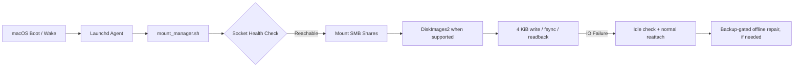

# LazyMount-Mac Documentation

> **Expand your Mac storage effortlessly** — Automated, resilient SMB and cloud storage mounting for macOS power users, NAS gamers, and homelab architects.

---

## 📚 Technical Guides & Troubleshooting

### High-Intent Troubleshooting & Deep Dives

1. **[Fixing Steam Disk Write Error on macOS](troubleshooting/steam-disk-write-error-macos.md)**  
   Diagnose ENOTSUP, EROFS, EACCES, and real I/O failures without assuming filesystem corruption. Covers safe reattachment and read/write verification.

2. **[APFS Sparsebundle NAS Recovery & Optimization](guides/apfs-sparsebundle-nas-recovery.md)**  
   Plist/UUID identity, verified writes, normal reattachment, backup-gated offline repair, and correct fsck parameter semantics.

3. **[Automounting SMB Shares on macOS Using Launchd](guides/macos-automount-smb-launchd.md)**  
   Overcoming Finder login item limitations with reliable, headless LaunchAgents, sleep/wake network checks, and macOS Keychain integration.

4. **[Rclone Cloud Storage Mount with Launchd & FUSE-T](guides/rclone-launchd-macos.md)**  
   Mounting cloud drives (Google Drive, Dropbox, SFTP, S3) with full VFS local caching on modern Apple Silicon Macs without reducing kernel security.

---

## ⚡ Quick Architecture Overview



---

## 🚀 Quick Start

```bash
# Clone repository
git clone https://github.com/yuanweize/LazyMount-Mac.git
cd LazyMount-Mac

# Install the per-user LaunchAgent and preserve any existing local settings
./install.sh install

# Set SMB, APFS, and/or Rclone settings without hardcoded usernames
nano ~/Scripts/mount_manager.local.sh

# Activate and inspect
./install.sh restart
./install.sh status
tail -n 40 ~/Library/Logs/LazyMount/manager.log
```

---

## 📄 Release notes and validation

Read [CHANGELOG](../CHANGELOG.md) for v3.0.0–v3.0.2 migration and [the v3 validation report](validation-v3.md) for real-image testing, ownership regression, and remaining limits.

---

## 📄 License & Maintainer

Maintained with care by **Weize Yuan** ([@yuanweize](https://github.com/yuanweize)).  
Licensed under the [MIT License](https://github.com/yuanweize/LazyMount-Mac/blob/main/LICENSE).
